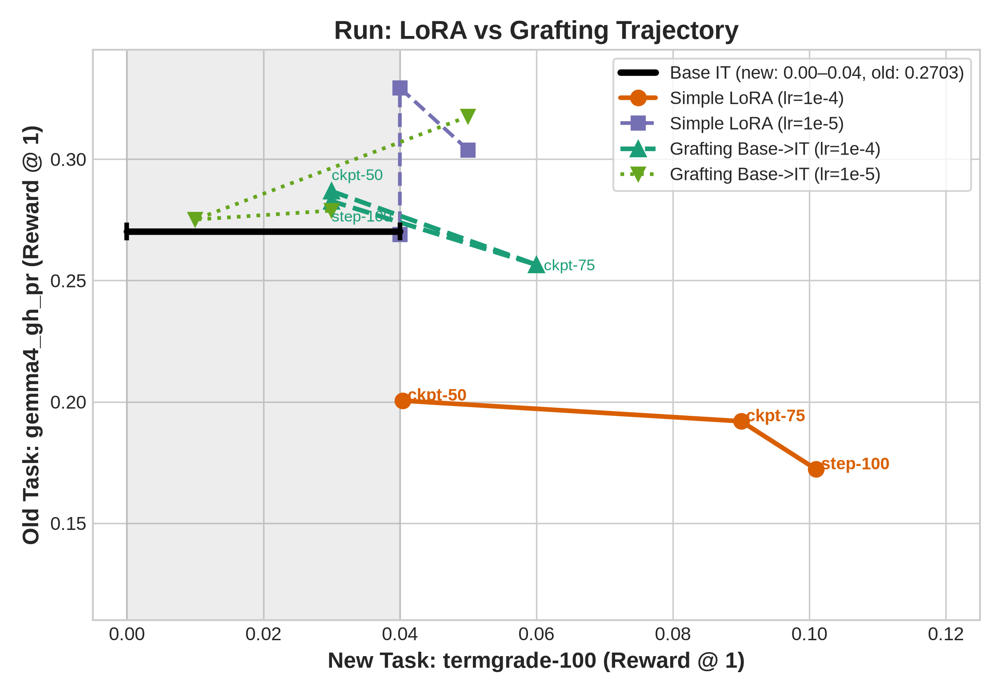
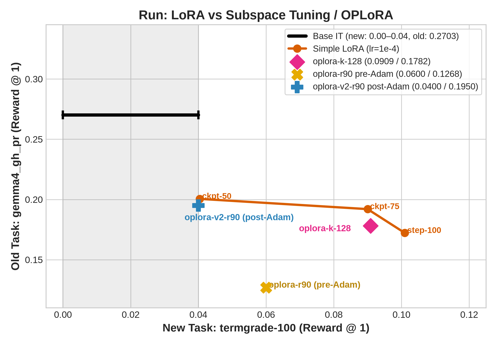
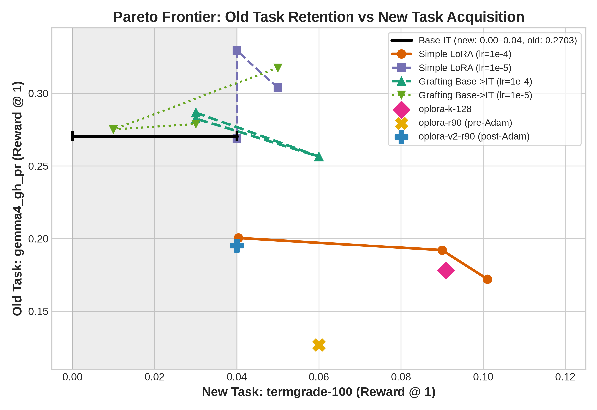

# LoRA Without Forget: Can Off-Policy LoRA Learn Without Forgetting?

When adapting pre-trained language models to new execution environments, fine-tuning faces a fundamental dilemma: either the model fails to acquire the new domain capabilities, or it suffers catastrophic forgetting, erasing previously established skills. In this writeup, we investigate continual learning with parameter-efficient fine-tuning (PEFT) on Google's Gemma 4 E4B across two distinct software engineering benchmark tasks: offline GitHub pull-request issue resolution (`gemma4_gh_pr`, 118 trials) and interactive multi-turn terminal execution (`termgrade-100`, 100 trials). We evaluate standard Low-Rank Adaptation (Simple LoRA), recent model grafting strategies, and Subspace Tuning (SST / OPLoRA) under a strict single-task training distribution without data replay. Our experiments yield three primary findings: First, while standard LoRA ($lr=10^{-4}$) more than doubles terminal task completion from $4.00\%$ to $10.10\%$, it suffers a $36.3\%$ collapse on GitHub PR patch generation ($0.2703 \to 0.1722$). Second, LoRA Grafting—training a donor adapter on the foundation base model and grafting it onto the instruction checkpoint—fails completely on Gemma 4, scoring an ineffective $0.0300$ reward. Third, while Subspace Tuning can protect pre-trained directions, standard OPLoRA implementations that constrain gradients during training fail to prevent forgetting, and post-step projection prevents forgetting only at the cost of freezing new-task learning.

## Introduction

How can a post-trained model acquire new execution skills without destroying its existing competencies? 
In the full fine-tuning (FT) literature, two new methods have recently emerged to combat catastrophic forgetting:
1. **Model Grafting (Wu et al., 2026)**: Rather than fine-tuning the aligned instruction-tuned model directly, one fine-tunes the early pre-trained base model ($\theta_{\text{base}}$) on the target domain data, extracts the parameter delta $\Delta W_{\text{base}} = \theta_{\text{base-ft}} - \theta_{\text{base}}$, and grafts it onto the instruction checkpoint ($\theta_{\text{it}}$):
   $$\theta_{\text{grafted}} = \theta_{\text{it}} + \lambda \Delta W_{\text{base}}$$
   Wu et al. demonstrate that this off-policy transfer preserves general instruction following while assimilating specialized domain skills.
2. **Subspace Tuning (SST; Chavan et al., 2026)**: Rather than modifying unconstrained weights, one identifies the principal singular directions of the pre-trained weights and restricts all fine-tuning updates strictly to their orthogonal complement:
   $$\Delta W = P_L \Delta W_0 P_R, \quad \text{where } P_L = I - U_k U_k^T, \; P_R = I - V_k V_k^T$$
   Freezing the top singular modes mathematically protects foundational representations while freeing the remaining space for downstream adaptation.

In resource-constrained environments where full-weight training and multi-task replay buffers are unavailable or computationally prohibitive, practitioners typically turn to Parameter-Efficient Fine-Tuning (PEFT) via Low-Rank Adaptation (LoRA).
Translating these continual learning paradigms into the PEFT regime reveals uncharted territory. In PEFT, applying LoRA grafting has remained completely unexplored. Conversely, applying Subspace Tuning to low-rank adapters directly mirrors Orthogonal Projection LoRA (OPLoRA; Xiong & Xie, 2025), where the low-rank factorized update $\Delta W = B A$ is constrained by orthogonal projectors $P_L$ and $P_R$.

However, when applied to real-world software engineering benchmarks on Gemma 4 E4B, both techniques encounter unexpected failure modes. Off-policy Grafting collapses due to coordinate mismatches between base and instruction representations, while standard OPLoRA still suffers catastrophic forgetting. Below, we systematically document these runs and trace their optimization mechanics.

## Harness & Dataset

Our investigation evaluates sequential task transfer across two distinct environments. `gemma4_gh_pr` evaluates offline code generation across 118 real-world GitHub issues using the `pi` coding harness, an offline tool-assisted patch synthesis environment where the model reads issue descriptions, explores repositories with tools, and generates unified git patches. Mined using a modified `repo2rlenv` (`github.com/carlesoctav/repo2rlenv`), the mining pipeline traverses PRs chronologically backwards from newer to older commits to maximize Docker layer cache reuse and minimize container rebuilds, with each task's tests live-verified in execution containers. We also rewrite messy discussion threads into natural prompts using `inkling-2-small`, and grade solutions via resolution rewards ($\text{f2p\_rate} \times \text{p2p\_factor}$). In contrast, the target benchmark, `termgrade-100`, evaluates multi-turn terminal execution across 100 heldout tasks via `terminus`, a multi-turn, tool-free interactive terminal harness where the model interacts directly with a raw bash shell without structured tool schemas, evaluated on binary task completion. `termgrade-100` was mined by running Gemma 4 E4B on the original `ai-and/termgrade-environments` terminal tasks and selecting 100 failed tasks as the heldout evaluation set.

Supervised fine-tuning on the target domain uses `ai-and/termgrade-trajectories` (`carlesoctav/termgrade-p95-split_sft`). A fix was applied to format raw multi-turn rollouts into viable supervised training instances: trajectories were unrolled into incremental conversational prompt-completion pairs, rollouts exceeding the 95th percentile token length were truncated to eliminate non-terminating bash loops, and prior assistant reasoning traces were stripped because `Gemma 4 E4B` multi-turn chat discards thoughts between turns, eliminating train-test conditioning mismatches. Our audit confirmed zero task overlap between the 699 training tasks and the 100 heldout evaluation tasks, ensuring strict out-of-distribution evaluation.

All runs use the following hyperparameters, with a sweep over the learning rate: 100 gradient steps, effective batch size 32 (batch size 8 with 4 gradient accumulation steps), max sequence length 16K tokens, cosine learning rate schedule with 10% warmup, learning rates $[10^{-4}, 10^{-3}, 10^{-5}]$, and LoRA adapters ($r=32, \alpha=32$) attached to `q_proj`, `k_proj`, `v_proj`, `o_proj`, `up_proj`, `down_proj`, and `gate_proj`.

## Run: LoRA vs Grafting

Our first empirical comparison contrasts direct on-policy adaptation against off-policy LoRA grafting. We initialize with `google/gemma-4-E4B-it` (Base IT), which scores an initial $0.2703$ mean reward on GitHub PRs. On the new terminal task, Base IT starts at $0.00$ strict task completion on the initial filter run (later repeat evaluations showed Base IT achieves up to $0.0400$). Under Simple LoRA ($lr=10^{-4}$), the adapter is trained directly on IT weights across 100 steps. Under LoRA Grafting ($lr=10^{-4}, \lambda=1$), the adapter is trained on the base foundation model `google/gemma-4-E4B` and transplanted onto the IT model during evaluation.

The phase plot below maps the trajectory of each method across checkpoints (Step 50, Step 75, Step 100) in the two-dimensional performance space of Old Task Retention (`gemma4_gh_pr` reward on the vertical axis) versus New Task Acquisition (`termgrade-100` reward on the horizontal axis). The Base model's new task profile is displayed as a capability range spanning from $0.00\text{--}0.04$.

The trajectory plot reveals two stark, divergent behaviors:

- **Trajectory 1: Simple LoRA:**
  Starting from Base IT, Simple LoRA rapidly moves rightward toward high new-task acquisition, reaching $0.0404$ at step 50, $0.0900$ at step 75, and peaking at $0.1010$ at step 100. However, this plasticity comes at a severe cost: the vertical position drops precipitously from $0.2703 \to 0.2005 \to 0.1920 \to 0.1722$. The model suffers a $36.3\%$ performance collapse on its prior GitHub PR coding capabilities.

- **Trajectory 2: LoRA Grafting:**
  In contrast, LoRA Grafting completely fails to move rightward. Across all checkpoints, new task completion remains pinned at a dismal $0.0300$ at step 50, briefly touches $0.0600$ at step 75, and returns to $0.0300$ at step 100, scoring no better than the untrained baseline range ($0.00\text{--}0.0400$). While it preserves vertical old-task reward ($0.2827$ at step 100), it demonstrates zero effective learning on the target domain.

Full-model grafting works when you fine-tune the *entire* Base model, because every layer shifts together. With LoRA, however, we only attach adapters to the attention and MLP linear projections (`q/k/v/o` and `gate/up/down`), leaving all other parameters—embeddings, layer norms, router/per-layer gates, and the output head—untouched. If Google's post-training rotated or rescaled those non-LoRA layers between `gemma-4-E4B` (Base) and `gemma-4-E4B-it` (IT), then a LoRA adapter trained inside the Base model speaks a different coordinate system than the IT model. To test this directly, we built a hybrid checkpoint (`carlesoctav/gemma4-e4b-mix`) that takes the attention/MLP weights from Base and everything else (embeddings, norms, head) from IT. Before a single gradient step is taken, the initial loss on the training data jumps to **$4.8833$**—compared to **$0.5$** on pure IT and **$0.6$** on pure Base. Because the Base linear layers and the IT embeddings/norms are already incompatible with each other, an adapter trained on Base cannot work when plugged into IT.

## Run: LoRA vs OPLoRA / SST

Having established that off-policy grafting cannot cross the Base-to-IT architectural divide, we turn to on-policy subspace regularization. Singular Subspace Tuning (SST) and OPLoRA freeze the principal (top-$k$) singular subspace of the pre-trained weights $W_0$, restricting LoRA adaptation to its orthogonal complement (the minor/residual singular subspace and nullspace) via double-sided orthogonal projection $P_L \Delta W P_R$. We compare Simple LoRA against three subspace configurations:

1. `oplora-k-128` (Light Protection): Freezes only the top 128 singular directions of each weight matrix (protecting roughly the top 5% of the model's strongest pre-trained features) and lets LoRA train freely in everything else.
2. `oplora-r90` (Heavy Protection, Gradient Constrained): Freezes the top 90% of the entire singular spectrum to strongly protect pre-trained knowledge, filtering the gradients during the backward pass before AdamW updates the weights.
3. `oplora-v2-r90` (Heavy Protection, Post-Step Constrained): Also freezes the top 90% of the spectrum, but lets AdamW step normally first and only projects the resulting weights afterward.

The phase plot below illustrates the trajectories and operating points of these approaches:

1. **`oplora-k-128` ($0.1782$ old / $0.0909$ new)** behaves almost identically to standard LoRA between step 75 ($0.1920$ / $0.0900$) and step 100 ($0.1722$ / $0.1010$) — freezing just 128 directions is too weak to stop forgetting.
2. **`oplora-r90` ($0.1268$ old / $0.0600$ new)** projects gradients *before* AdamW, which corrupts AdamW's second-moment scaling and makes both old and new task performance worse than standard LoRA.
3. **`oplora-v2-r90` ($0.1950$ old / $0.0400$ new)** fixes the AdamW issue by projecting *after* the step, recovering old-task score ($0.1950$), but locking 90% of the spectrum leaves no room to learn the new task ($0.0400$) — landing in the exact same spot as simply stopping Simple LoRA at checkpoint 50 ($0.2005$ old / $0.0404$ new).

## References

- Chavan, A., Shen, Z., Zhuang, B., Liu, Z., Darrell, T., & Keutzer, K. (2026). Towards Continual Learning: Mitigating Forgetting With Subspace Tuning. *arXiv preprint arXiv:2610.22293*.
- Wu, T., Zhang, M., & Raghunathan, A. (2026). Off-Policy Merging Beats On-Policy Self-Distillation for Continual Learning. *arXiv preprint arXiv:2610.05872*.
- Xiong, Y., & Xie, X. (2025). OPLoRA: Orthogonal Projection LoRA Prevents Catastrophic Forgetting during Parameter-Efficient Fine-Tuning. *arXiv preprint arXiv:2510.13003*.
